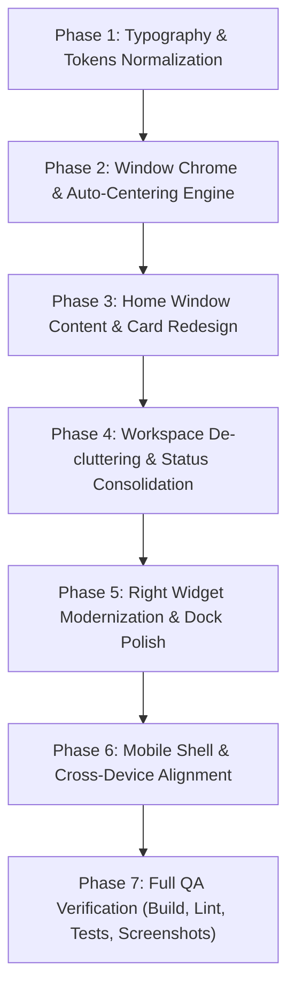

# Multiverse-OS Frontend UI Redesign & Layout Architectural Plan
**Version:** 1.0.0  
**Target Date:** November 2026  
**Skill Reference:** `/agent-skills:frontend-ui-engineering`  
**Status:** Ready for Review & Implementation  

---

## 1. Executive Summary & Visual Audit

Following visual inspection and code auditing of the current desktop and mobile interfaces, the frontend layout suffers from critical visual hierarchy, spacing, positioning, and aesthetic defects that make the portfolio feel like an unpolished prototype rather than a production-grade Web OS developed by a senior backend/systems engineer.

```
Current Desktop Layout Deficiencies:
┌──────────────────────────────────────────────────────────────────────────────┐
│ [MenuBar: MULTIVERSE // OS]                                [Clock / Status]  │
│ [INDEXING: branding_identity] (Phantom scan rectangle floating top-left)      │
├─────────────────────────┬───────────────────────────────┬────────────────────┤
│                         │                               │                    │
│ [Workstation Home]      │ <--- 550px DEAD VOID --->     │ [01:07 Clock]      │
│ (Hardcoded x:80, y:40)  │ (Empty wallpaper gap on       │ [21°C Weather]     │
│ [File Edit Telemetry]   │  standard 1080p/1440p)        │ [CPU: 14%]         │
│  ↳ Fake mockup toolbar  │                               │ [RAM: 4.29 GB]     │
│                         │                               │ [Narrative Router] │
│ Suraj Samanta           │                               │                    │
│ BACKEND DEVELOPER...    │                               │ (Hides completely  │
│                         │                               │  below 1280px)     │
│ [Recruiter] [Projects]  │                               │                    │
│                         │                               │                    │
│ ┌──────────┐ ┌────────┐ │                               │                    │
│ │ Oracle AI│ │ CLI... │ │                               │                    │
│ └──────────┴─┴────────┴─┤                               │                    │
│ ⚠️ CARDS CUT OFF HERE    │                               │                    │
├─────────────────────────┴───────────────────────────────┼────────────────────┤
│                    [Dock: 11 icons]                     │ [Robot Helper]     │
│                                                         │ [✨ Oracle Fab]    │
│                                                         │ [>_ Terminal Fab]  │
│                                                         │ [SYS_STATUS pill]  │
│                                                         │ ↳ 4x CLUTTERED     │
└─────────────────────────────────────────────────────────┴────────────────────┘
```

### 1.1 The Specific Layout Breakages Identified

1. **Severe Dead Space & Asymmetric Window Positioning**:
   - The Home window defaults to hardcoded coordinates (`x: 80, y: 40`).
   - On a standard 1080p screen (1920×1080), the 900px-wide window sits hugging the far left, while the 336px widget column sits pinned at `right-8`.
   - This creates an enormous **~550px wide blank void** directly in the center of the display.
   - On viewports between 1024px and 1279px (laptops and tablets in landscape), `hidden xl:flex` hides the widget column completely, leaving an even worse 900px empty chasm on the right.

2. **Window Clipping & Vertical Overflow**:
   - `windowRegistry.ts` hardcodes `home: { defaultWidth: 900, defaultHeight: 620 }`.
   - The window chrome consumes `44px` (titlebar) + `36px` (mock toolbar) + `22.5px` (window body padding) + `40px` (content padding) = **~143px** before any text renders.
   - The hero title, badges, subtitle, call-to-actions, and console cards require **~640px** of vertical space.
   - As a result, the bottom half of the centerpiece console cards (**Oracle AI Assistant** and **Interactive CLI Terminal**) is clipped off by the bottom window boundary, cutting off card actions, shortcut badges, and text.

3. **Useless Mock Toolbars (`File / Edit / Telemetry / WS_READY //`)**:
   - Every window without a custom toolbar renders a dummy `h-9` toolbar containing non-functional items (`File`, `Edit`, `Telemetry`, `WS_READY //`).
   - These consume 36px of critical vertical screen space and communicate "unfinished wireframe" rather than high craftsmanship.

4. **Bottom-Right Corner Clutter & 4x Redundancy**:
   - The bottom-right corner currently crams four competing floating controls into one spot:
     - `RobotLayer` companion banner (`Telemetry Companion OS Helper SCANNING` at `bottom-20 right-6`).
     - Floating circular Oracle trigger button (`w-11 h-11` with `Sparkles`).
     - Floating circular Terminal trigger button (`w-11 h-11` with `Terminal`).
     - System Status pill (`SYS_STATUS: NOMINAL | AUDIO: ACTIVE`).
   - The floating buttons for Oracle and Terminal are **quadruply redundant**: they already exist in the Dock (positions 4 & 5), in the centerpiece Home cards, in Spotlight Search (`⌘K`), and via keyboard shortcuts (`Alt+O`, `Ctrl+``).

5. **Misleading Window Header States**:
   - In `DesktopWindow.tsx`, the top-right label displays `{isActive ? 'Active' : 'Muted'}`.
   - Displaying `"Muted"` when a window loses focus is confusing because "muted" is an audio term. Users mistakenly believe system audio has been silenced.

6. **Distracting Phantom Scan Boxes**:
   - `RobotLayer` animates rectangular bounding boxes (`INDEXING: branding_identity`, `SCANNING: telemetry_clock_widget`) across arbitrary screen coordinates.
   - In production, these look like rendering bugs or glitchy CSS outline artifacts.

7. **Muddy Color Contrast in Default Theme**:
   - In `styles/variables.css`, the default theme is `PastelOS Light`:
     - Desktop background: `#dcebe8` (washed-out sage mint).
     - Window panel: `#f7f2eb` (beige/cream).
     - Card background inside window: `bg-bg-panel/40` (translucent beige on beige).
   - This beige-on-sage palette lacks depth, structure, and contrast. Elements blend into an uninspiring muddy mass.

8. **Global Font-Size & Override Regressions**:
   - In `styles/globals.css`, `html { font-size: 18px; }` was set with blanket `.text-[xpx] !important` overrides.
   - This caused micro-text badges and metadata intended to be 10px-11px to jump to `14.6px`, overflowing card footers and distorting dock layout math.

---

## 2. Design System & Visual Contract

Per the `frontend-ui-engineering` skill standards:

| Dimension | Current Flaw | Target Production Standard |
| :--- | :--- | :--- |
| **Window Layout** | Hardcoded `x: 80, y: 40` with asymmetric chasm | Viewport-aware auto-centering with balanced desktop gutters |
| **Window Dimensions** | `900 x 620` causing severe content clipping | `960 x 740` (or dynamic `min(90vw, 960px)` × `min(82vh, 740px)`) ensuring zero content truncation |
| **Window Chrome** | Non-functional `File / Edit / Telemetry` mock bar | Clean macOS/visionOS style titlebar with traffic lights, centered title, zero fake toolbars |
| **Visual Hierarchy** | Beige-on-sage soup with low contrast | Crisp dimensional slate/dark or refined warm canvas with distinct surfaces, subtle 1px borders, and natural shadows |
| **Floating Overlays** | 4 competing widgets stacked in bottom-right | Clean consolidated status tray in MenuBar / Dock; zero redundant floating FABs |
| **Companion Agent** | Floating banner with phantom scan boxes | Integrated status companion inside the MenuBar or Dock status tray |
| **Typography Scale** | `html { font-size: 18px; }` + brute force `!important` | Standard `16px` base rem scale with Tailwind semantic steps (`text-xs`, `text-sm`, `text-base`) |
| **Dock Style** | Flat launcher crowding bottom right | Premium frosted glass dock (`backdrop-blur-xl`), active running indicator dots, subtle spring scale |

---

## 3. Targeted Layout Redesign Architecture

### 3.1 Workspace & Window Placement Engine

```
Target Centered & Balanced Workspace Layout:
┌──────────────────────────────────────────────────────────────────────────────┐
│ [MULTIVERSE // OS]   [System] [View] [Terminal]       [SYS: NOMINAL 🟢] [01:07]│
├──────────────────────────────────────────────────────────────────────────────┤
│                                                                              │
│             ┌───────────────────────────────────────────────┐                │
│             │  ● ● ●           Workstation Home             │                │
│             ├───────────────────────────────────────────────┤                │
│             │                                               │                │
│             │      ● SYSTEM OPERATIONAL // ONLINE           │   [Clock]      │
│             │                                               │   [Stats]      │
│             │               Suraj Samanta                   │   [Widgets]    │
│             │   BACKEND DEVELOPER | AI ENGINEER | ARCHITECT │   ↳ Docked or  │
│             │                                               │     collapsible│
│             │ Architecting high-performance distributed     │     into right │
│             │ systems, low-latency APIs & agent pipelines.  │     gutter     │
│             │                                               │                │
│             │       [ Recruiter Mode ]   [ View Projects →] │                │
│             │                                               │                │
│             │   ┌─────────────────────┐ ┌─────────────────┐ │                │
│             │   │ ✨ Oracle Assistant │ │ >_ CLI Terminal │ │                │
│             │   │ Query qualifications│ │ Interactive cmd │ │                │
│             │   │ Alt + O  ➔ Launch   │ │ Ctrl+` ➔ Open   │ │                │
│             │   └─────────────────────┘ └─────────────────┘ │                │
│             │                                               │                │
│             │      📄 DOWNLOAD_RESUME  /  ✉️ CONTACT_DIRECT  │                │
│             └───────────────────────────────────────────────┘                │
│                                                                              │
│                     [ 🏠  💼  👤  ✨  >_  📅  📄  ✉️  ⚙️ ]                    │
└──────────────────────────────────────────────────────────────────────────────┘
```

#### Key Implementation Changes:
1. **Dynamic Centering Calculation in `DesktopProvider.tsx`**:
   ```ts
   const calculateDefaultPosition = (id: string, width: number, height: number) => {
     if (typeof window === 'undefined') return { x: 80, y: 40 };
     
     // Menu bar height = 44px, Dock safe height = 80px
     const availWidth = window.innerWidth;
     const availHeight = window.innerHeight - 44 - 80;
     
     if (id === 'home') {
       // Center the home window in the viewport
       const x = Math.max(20, Math.floor((availWidth - width) / 2));
       const y = Math.max(54, Math.floor((availHeight - height) / 2) + 44);
       return { x, y };
     }
     
     // Cascading stagger for secondary windows
     const staggerOffset = (staggerCount % 5) * 28;
     const x = Math.max(40, Math.min(availWidth - width - 40, 100 + staggerOffset));
     const y = Math.max(60, Math.min(availHeight - height - 20, 70 + staggerOffset));
     return { x, y };
   };
   ```

2. **Update Default Dimensions in `WindowRegistry.ts`**:
   - `home`: Expand from `900 × 620` to `960 × 740` (with responsive max clamp `min(width, innerWidth - 40)`).
   - `projects`: `920 × 660`.
   - `terminal`: `820 × 520`.
   - `dashboard`: `1060 × 740`.
   - `resume`: `860 × 700`.

---

### 3.2 Streamlined Window Chrome (`DesktopWindow.tsx`)

1. **Eliminate Non-Functional Toolbars**:
   - Remove the default `<div className="h-9 border-b ..."> File Edit Telemetry WS_READY // </div>`.
   - Only render a toolbar when a window provides an actual functional component via `props.toolbar`.

2. **Clean Window Header Titlebar**:
   - macOS-style traffic lights on the left: Close (red), Minimize (amber), Maximize (green).
   - Window title centered in the titlebar with subtle font-weight (`font-medium text-sm text-text-primary`).
   - Right status slot: Replace confusing `"Muted"` with a subtle focus indicator dot or remove the text entirely so it looks clean and native.

3. **Window Content Padding**:
   - Change outer window body from `p-5` to `p-0`.
   - Let content components (`HomeWindowContent`, `ProjectsAppContent`, etc.) control their own internal scrolling and padding cleanly, preventing nested double-padding traps.

---

### 3.3 Home Window Content Refinement (`HomeWindowContent.tsx` & `HomeConsoleWidgets.tsx`)

1. **Tighten Vertical Rhythm**:
   - Change outer wrapper from `px-6 py-10` to `px-6 py-7 sm:px-8 sm:py-8`.
   - Hero Name: `text-3xl sm:text-5xl font-extrabold tracking-tight mb-2`.
   - Titles subtitle: `text-xs sm:text-sm font-mono tracking-wider mb-4`.
   - Value proposition: `text-sm sm:text-base text-text-secondary max-w-xl mx-auto leading-relaxed mb-6`.
   - CTA Row: Primary Recruiter button + Outline Projects button with clean `gap-3.5`.

2. **Console Cards Grid Refinement**:
   - In `HomeConsoleWidgets.tsx`:
     - Reduce outer margin: `mt-7` (instead of `mt-12`).
     - Card padding: `p-5` (instead of `p-6`).
     - Card titles: `text-lg sm:text-xl font-bold mb-1.5`.
     - Description: `text-xs sm:text-sm text-text-secondary leading-normal mb-4`.
     - Footer bar: `pt-2.5 mt-auto flex items-center justify-between text-xs font-mono`.
   - **Guaranteed Result**: The entire Home window content renders completely visible without any vertical scrollbar or clipped cards on standard desktop displays.

---

### 3.4 De-Cluttering Bottom-Right Floating Elements

1. **Remove Redundant FABs in `ShellProvider.tsx`**:
   - Remove `<button onClick={toggleOracle}>` (sparkles floating circle).
   - Remove `<button onClick={toggleCli}>` (terminal floating circle).
   - Both are already prominent in the Dock, the Home window cards, Spotlight search, and keyboard shortcuts.

2. **Relocate System Status & Audio Toggle**:
   - Move `{isAudioMuted ? 'AUDIO: MUTED' : 'AUDIO: ACTIVE'}` and `{systemStatus}` into the **Top MenuBar** on the right side.
   - The top menu bar is the canonical location for system indicators in macOS, Linux, and Windows.
   - This keeps the bottom workspace completely clean and unobstructed.

3. **Clean Up `RobotLayer.tsx`**:
   - Remove arbitrary ghost bounding boxes (`INDEXING: branding_identity`).
   - Reposition the companion avatar into a discreet dock accessory or status badge in the MenuBar.

---

### 3.5 Right Widget Layer Modernization (`WidgetLayer.tsx`)

1. **Integrated Glass Gadget Design**:
   - Instead of an isolated 336px column floating in dead space, style widgets with modern glassmorphism that nests subtly into the desktop background.
   - Combine Clock + Date + Weather into a unified, elegant **At-a-Glance Dashboard Card**.
   - Streamline CPU & RAM into a compact telemetry pill.
   - Remove the redundant "Narrative Core Router" card (since Oracle is already in Dock, Home cards, and MenuBar).

2. **Responsive Handling**:
   - On wide screens (`>= 1440px`), widgets sit elegantly along the right gutter with balanced spacing.
   - On standard screens (`1024px - 1439px`), windows center cleanly without overlapping, and widgets can be toggled via a "Widgets" trigger in the MenuBar.

---

### 3.6 Theme, Contrast & Visual Polish

1. **PastelOS Light (Default Theme)**:
   - Enhance contrast and surface definition:
     - Desktop wallpaper: Refined airy slate-tinted canvas (`#e8edf2`).
     - Window container: Pure crisp surface (`#ffffff` / `#fbfcfe`) with subtle 1px border (`rgba(15, 23, 42, 0.08)`).
     - Card background: Subtle surface inset (`#f1f5f9` / `#f8fafc`).
     - Text primary: Deep rich slate (`#0f172a` instead of washed-out charcoal).
     - Text secondary: Crisp slate-gray (`#475569` instead of muddy `#6a6d70`).
     - Shadows: Multi-layer ambient diffused shadow (`0 20px 40px -15px rgba(15, 23, 42, 0.12), 0 0 1px 1px rgba(15, 23, 42, 0.05)`).

2. **Obsidian Dark & Other Themes**:
   - Ensure surface contrast and subtle borders match the refined window frame design.

---

### 3.7 Typography & Global Styles Cleanup (`styles/globals.css`)

1. **Normalize Root Font-Size**:
   - Restore `html { font-size: 16px; }` (standard 1rem = 16px).
   - This ensures all browser rem calculations, Tailwind spacing utilities, and responsive breakpoints align with standard web specifications.

2. **Remove Brute-Force Overrides**:
   - Delete `.text-[6px]`, `.text-[7px]`, `.text-[8px]`, `.text-[9px]`, `.text-[10px]`, `.text-[11px]` rules that had `!important` font sizes.
   - Replace any micro-text in components with semantic classes:
     - Badges / metadata: `text-xs font-mono font-medium`.
     - Small descriptions: `text-sm text-text-secondary`.
     - Headings: semantic `text-base`, `text-lg`, `text-xl`, `text-2xl`, `text-4xl`.

---

## 4. Implementation Plan & Phases



### Detailed Phase Breakdown

| Phase | Target Components | Tasks | Expected Outcome |
| :--- | :--- | :--- | :--- |
| **Phase 1** | `styles/globals.css`<br>`styles/variables.css`<br>`theme/typography.ts` | 1. Reset `html { font-size: 16px }`<br>2. Remove `.text-[x] !important` overrides<br>3. Polish Default Theme color tokens for crisp contrast | Normal base sizing, sharp text contrast, no swollen UI elements |
| **Phase 2** | `desktop/DesktopProvider.tsx`<br>`desktop/WindowRegistry.ts`<br>`desktop/DesktopWindow.tsx` | 1. Implement auto-centering positioning algorithm<br>2. Expand default window dimensions to `960×740`<br>3. Eliminate non-functional `File/Edit` dummy toolbars<br>4. Clean window titlebar and remove `"Muted"` label | Windows open centered and balanced; zero dummy toolbars; clean native titlebars |
| **Phase 3** | `desktop/HomeWindowContent.tsx`<br>`components/HomeConsoleWidgets.tsx` | 1. Tighten hero spacing and padding<br>2. Refine Oracle and CLI console cards grid<br>3. Ensure all content fits without clipping or scrollbars | No card truncation; full content fits gracefully within default window |
| **Phase 4** | `components/ShellProvider.tsx`<br>`desktop/MenuBar.tsx`<br>`desktop/RobotLayer.tsx` | 1. Remove floating circular FABs from bottom-right<br>2. Relocate System Status & Audio toggle to MenuBar<br>3. Eliminate distracting phantom scan boxes | Bottom-right clutter eliminated; clean desktop workspace |
| **Phase 5** | `desktop/WidgetLayer.tsx`<br>`desktop/Dock.tsx` | 1. Redesign widgets into a unified, compact At-a-Glance card<br>2. Refine frosted dock with running indicator dots | Cohesive desktop widgets; polished macOS-style dock |
| **Phase 6** | `mobile/MobileHome.tsx`<br>`mobile/HomeLayout.tsx` | 1. Validate mobile sheet sliding and card layout<br>2. Verify responsiveness at 320px, 768px, 1024px, 1440px | Seamless experience across mobile, tablet, and desktop |
| **Phase 7** | All project code | 1. Prettier check (`npm run format:check`)<br>2. ESLint (`npm run lint`)<br>3. TypeScript check (`tsc --noEmit`)<br>4. Turbopack Build (`npm run build`)<br>5. Oracle Regression Suite (`npm test`) | Zero regressions, 100% CI compliance, production-ready quality |

---

## 5. Verification Checklist

- [ ] Window opens centered with balanced margins on 1080p, 1440p, and 4K displays.
- [ ] No centerpiece cards or buttons in `Workstation Home` are truncated by the window frame.
- [ ] Dummy toolbars (`File / Edit / Telemetry / WS_READY //`) are completely removed.
- [ ] Bottom-right corner clutter is gone; redundant floating FABs are removed.
- [ ] System status and audio toggles reside cleanly in the Top MenuBar.
- [ ] Text contrast meets WCAG 2.1 AA (4.5:1 for body copy, 3:1 for large text).
- [ ] Dock displays running indicator dots for active windows with smooth hover magnification.
- [ ] Full CI gates pass: Prettier, ESLint, TypeScript, Turbopack production build, and all 37 test cases.
