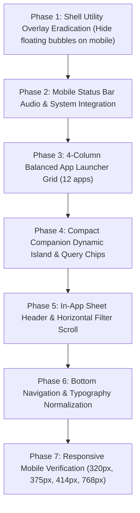

# Multiverse-OS Mobile UI Redesign & Layout Architectural Plan
**Version:** 1.0.0  
**Target:** Mobile & Touchscreen Viewports (< 1024px)  
**Skill Reference:** `/agent-skills:frontend-ui-engineering`  
**Status:** Ready for Review & Implementation  

---

## 1. Executive Summary & Root Cause Analysis

On mobile screens (smartphones and small touch devices), the current interface is described by the user as **"looking absolute garbage as the buttons are all over the place"**.

Our code audit reveals exact structural reasons for this breakdown:

```
CURRENT BROKEN MOBILE LAYOUT (Viewports < 1024px):
┌────────────────────────────────────────────────────────┐
│ [StatusBar: Suraj.OS Mobile | 5G 98% 🔋]               │
├────────────────────────────────────────────────────────┤
│ 01:07                                                  │
│ MON, NOV 2 | ● ONLINE                                  │
│                                                        │
│ ┌────────────────────────────────────────────────────┐ │
│ │ 🤖 Huge 120px Robot Companion Card (Pushes apps)   │ │
│ └────────────────────────────────────────────────────┘ │
│                                                        │
│ SYSTEM APPLICATIONS (3-Column Grid with 10 Apps):      │
│ [About]       [Projects]      [Skills]                 │
│ [Timeline]    [CV Resume]     [Contact]                │
│ [Recruiter]   [GitHub]        [Settings]               │
│ [Retro Arcade]  <--- ⚠️ LONE ORPHAN BUTTON ON ROW 4!   │
│                                                        │
│ QUICK ASSISTANT QUERIES:                               │
│ [Explain Suraj's microservice experience...          ] │
│ [What database optimizations does he perform?        ] │
│                                                        │
│ ⚠️ CATASTROPHIC FLOATING OVERLAY COLLISION:            │
│ ┌────────────────────────────────────────────────────┐ │
│ │                                    [✨ Floating O] │ │ <--- z-[9980]
│ │                                    [>_ Floating T] │ │ <--- Covers bottom
│ │                                  [SYS_STATUS pill] │ │ <--- and Nav Bar!
│ └────────────────────────────────────────────────────┘ │
├────────────────────────────────────────────────────────┤
│ [Terminal]               [Home]               [Oracle] │ <--- z-[100]
│ (Nav Bar covered by floating buttons!)                 │
└────────────────────────────────────────────────────────┘
```

### 1.1 The Specific Root Causes of "Buttons All Over the Place"

1. **Floating Utility Region Collision (`components/ShellProvider.tsx`)**:
   - `ShellProvider` renders `id="shell-utility-region"` with `fixed bottom-4 right-4 z-[9980]`.
   - It contains:
     - Floating circular Oracle button (`w-11 h-11` with `Sparkles`)
     - Floating circular Terminal button (`w-11 h-11` with `Terminal`)
     - Floating status capsule (`SYS_STATUS: NOMINAL | AUDIO: ACTIVE`)
   - **Crucial bug**: There is **NO responsive hiding** (no `hidden lg:flex`).
   - On a phone screen (375px - 430px wide), these 3 floating controls hover directly over the bottom-right quadrant of the screen.
   - They sit directly on top of the `BottomNavigation` bar's "Oracle" button and cover the content of every open app sheet (including input bars, form buttons, and back controls).
   - This creates two Oracle buttons, two Terminal buttons, and an audio pill all colliding in the same corner!

2. **The Asymmetric 10-Item App Grid (`mobile/MobileHome.tsx`)**:
   - The app launcher uses `grid grid-cols-3 gap-x-4 gap-y-5` with **10 items**.
   - 10 divided by 3 leaves **Row 4 with 1 lone app (`Retro Arcade`) stranded on the far left**, leaving 2 blank column slots. This looks broken and amateurish.
   - The icon container uses `w-13 h-13` (an invalid non-standard Tailwind class).
   - App labels are hit by `styles/globals.css` `.text-[10px] { font-size: 0.8125rem !important; }` (14.6px!), causing labels like "Retro Arcade", "GitHub Files", and "Skills Map" to wrap onto multiple lines or get truncated into "Retro Arca...", "GitHub Fil...".

3. **Bulky Robot Card Pushing Content Off-Screen**:
   - `MobileHome.tsx` has a large 120px tall companion robot card right above the apps.
   - Combined with the status bar (36px) and clock (70px), over 230px of vertical space is consumed before the user sees a single app icon.
   - Users are forced to scroll to reach the apps, where they immediately hit the overlapping floating buttons.

4. **Multi-Row Button Wrapping in App Sub-Screens**:
   - In `ProjectsAppContent`, category filter buttons (`All`, `Featured`, `Backend`, `AI / ML`, `Systems`) are in a loose `flex-wrap` container that breaks into 3 uneven rows on mobile, pushing the search input and project list down.
   - In `DashboardAppContent` (Recruiter Mode), desktop-oriented metric tables and tab headers overflow horizontally and vertically on small screens.

5. **Audio Controls Trapped in the Bottom-Right Floating Pill**:
   - The only way to toggle audio or check system status on mobile is to tap the tiny button inside the floating pill that overlaps the bottom navigation.
   - Tapping it often mis-clicks into the Oracle tab or the floating Terminal button.

---

## 2. Target Mobile Design & Visual Contract

Per the `frontend-ui-engineering` skill:

```
TARGET POLISHED MOBILE OS LAYOUT:
┌────────────────────────────────────────────────────────┐
│ [01:07]             [🔊 AUDIO]     [SYS: NOMINAL 🟢]    │ <--- Clean Mobile Top Bar
├────────────────────────────────────────────────────────┤
│                                                        │
│   01:07                                                │
│   Monday, November 2                                   │
│                                                        │
│   ┌──────────────────────────────────────────────────┐ │
│   │ 🤖 OS Helper  ● Ready  |  Tap to ask Oracle...   │ │ <--- Compact Pill (40px)
│   └──────────────────────────────────────────────────┘ │
│                                                        │
│   SYSTEM APPLICATIONS                                  │
│   ┌──────┐     ┌──────┐     ┌──────┐     ┌──────┐      │
│   │  👤  │     │  💼  │     │  🧭  │     │  📅  │      │ <--- Balanced 4-Col Grid
│   │About │     │Projects│   │Skills│     │Timeline│    │
│   └──────┘     └──────┘     └──────┘     └──────┘      │
│   ┌──────┐     ┌──────┐     ┌──────┐     ┌──────┐      │
│   │  📄  │     │  🛡️  │     │  📁  │     │  ✉️  │      │
│   │Resume│     │Recruiter│  │GitHub│     │Contact│     │
│   └──────┘     └──────┘     └──────┘     └──────┘      │
│   ┌──────┐     ┌──────┐     ┌──────┐     ┌──────┐      │
│   │  🕹️  │     │  ⚙️  │     │  >_  │     │  ✨  │      │ <--- 12 Apps (3 x 4 Grid)
│   │Arcade│     │Settings│   │Terminal│   │Oracle│      │      PERFECT BALANCE!
│   └──────┘     └──────┘     └──────┘     └──────┘      │
│                                                        │
│   QUICK TOPICS (Horizontal Swipeable Chips):           │
│   [ 💬 Microservices ] [ ⚡ Distributed ] [ 📄 Resume ]│
│                                                        │
├────────────────────────────────────────────────────────┤
│       [ Terminal ]      [ Home ]      [ Oracle ]       │ <--- 100% UNRESTRICTED
│       (No floating bubbles covering this bar!)         │      NATIVE BOTTOM NAV
└────────────────────────────────────────────────────────┘
```

| Dimension | Current Broken State | Target Production Standard |
| :--- | :--- | :--- |
| **Floating Overlays** | 3 floating controls at `z-[9980]` covering the screen | **Completely hidden on mobile** (`hidden lg:flex`). Zero overlapping bubbles. |
| **App Grid Balance** | 10 apps in 3 columns (orphan button on row 4) | **12 apps in a 4×3 grid** (4 columns, iOS/Android standard, perfectly balanced). |
| **App Icon & Label** | Invalid `w-13 h-13` + forced 14.6px text truncation | Standard `w-14 h-14` rounded-2xl squircles + clean `text-xs font-medium` labels. |
| **Companion Widget** | Heavy 120px card pushing apps off-screen | Compact 40px "Dynamic Island" status pill with mini animated robot. |
| **Audio & Status** | Trapped in overlapping bottom-right pill | Clean 1-tap sound icon and nominal indicator in `StatusBar.tsx`. |
| **Query Buttons** | Tall full-width blocks covered by floating buttons | Elegant horizontal swipeable chips (`flex gap-2 overflow-x-auto`). |
| **Filter Buttons** | Loose wrapping buttons breaking into 3 rows | Smooth horizontal-scrolling segmented chip row. |
| **Bottom Navigation** | Obscured by floating buttons + text swollen | Clean frosted glass bar with proper safe-area padding and sharp typography. |

---

## 3. Detailed Component-by-Component Redesign

### 3.1 `components/ShellProvider.tsx`: Eradicate Mobile Overlays

Add responsive breakpoints to `shell-utility-region`:
```tsx
{/* Utility Region Slot — Strictly desktop only */}
<div
  id="shell-utility-region"
  className="hidden lg:flex fixed bottom-4 right-4 pointer-events-none z-[9980] flex-col items-end gap-2.5 font-mono text-xs"
>
  ...
</div>
```
- **Immediate Result**: Floating Oracle button, floating Terminal button, and floating status pill completely vanish on screens `< 1024px`.
- Mobile screens are instantly freed from overlay obstruction, allowing the native `BottomNavigation` bar and in-app views to receive 100% clean touch events.

---

### 3.2 `mobile/StatusBar.tsx`: Integrated Audio & System Controls

Transform the static status bar into a functional mobile system bar:
1. **Left**: Current time (`font-semibold text-text-primary text-xs`).
2. **Center**: System Status badge (`● NOMINAL` in muted green).
3. **Right**:
   - Quick Audio Toggle button: `<button onClick={toggleAudio}>` with `Volume2` / `VolumeX` icon (minimum 44×44px touch target).
   - Battery indicator & network type (`5G`).

---

### 3.3 `mobile/MobileHome.tsx`: Balanced 4-Column App Launcher & Compact Header

1. **Curate a Complete 12-App (4 × 3) Grid**:
   - **Row 1 (Core Profile)**: `About Me` (User), `Projects` (Briefcase), `Skills Matrix` (Compass), `Timeline` (Calendar).
   - **Row 2 (Credentials & Work)**: `CV Resume` (FileText), `Recruiter Mode` (ShieldAlert), `GitHub Files` (Folder), `Contact` (Mail).
   - **Row 3 (Tools & System)**: `Retro Arcade` (Gamepad2), `Settings` (Settings), `CLI Terminal` (Terminal), `Oracle Assistant` (Sparkles).
   - **Outcome**: A 4-column by 3-row layout is universally recognized by mobile users. Every row has exactly 4 apps. Zero orphan buttons.

2. **Standardize App Icon Styling**:
   - Container: `w-14 h-14 rounded-2xl flex items-center justify-center shadow-sm border border-border-subtle/30 bg-card-bg`.
   - Icon: `w-6 h-6`.
   - Label: `text-xs font-sans font-medium text-text-primary text-center truncate w-full px-1 mt-1.5`.

3. **Streamline Header & Companion Widget**:
   - Time: `text-4xl font-light text-text-primary`.
   - Date: `text-xs font-mono text-text-secondary uppercase tracking-wider`.
   - Compact Companion Pill:
     - Replace the 120px card with a slim 42px interactive pill:
       ```tsx
       <button
         onClick={() => setActiveTab('oracle')}
         className="w-full py-2.5 px-4 rounded-xl bg-bg-panel/40 border border-border-subtle/40 flex items-center justify-between text-left active:scale-98 transition-all"
       >
         <div className="flex items-center gap-2.5">
           <span className="w-2 h-2 rounded-full bg-accent-cyan animate-pulse" />
           <span className="text-xs font-sans font-medium text-text-primary">
             Ask Oracle AI about Suraj...
           </span>
         </div>
         <ArrowRight className="w-4 h-4 text-accent-cyan" />
       </button>
       ```

4. **Horizontal Swipeable Quick Query Chips**:
   - Replace the stacked full-width buttons with a horizontal scrollable chip row:
     ```tsx
     <div className="flex gap-2 overflow-x-auto pb-2 scrollbar-none select-none -mx-4 px-4">
       {quickQueries.map((q, idx) => (
         <button
           key={idx}
           onClick={() => triggerOracleQuery(q)}
           className="px-3.5 py-2 rounded-xl bg-bg-panel/30 border border-border-subtle/40 text-xs font-sans text-text-secondary whitespace-nowrap active:scale-95 transition-all flex items-center gap-2 flex-shrink-0"
         >
           <span>{q}</span>
           <ArrowRight className="w-3 h-3 text-accent-cyan" />
         </button>
       ))}
     </div>
     ```

---

### 3.4 `mobile/BottomNavigation.tsx`: Polished Touch Navigation

1. **Height & Safe Area**:
   - Set height to `h-16` with proper `pb-[env(safe-area-inset-bottom)]`.
   - Background: `bg-bg-panel/95 backdrop-blur-xl border-t border-border-subtle/40`.
2. **Tab Layout**:
   - 3 tabs: `Terminal`, `Home`, `Oracle`.
   - Icon: `w-5 h-5`.
   - Label: `text-[10px] font-sans font-medium tracking-tight mt-0.5`.
   - Active state: Distinct accent color highlight with subtle spring pill indicator.

---

### 3.5 In-App Sheet Experience (`mobile/HomeLayout.tsx`)

1. **Top Sheet Header**:
   - Fixed `h-13` header with a prominent Back button:
     - `<button onClick={closeApp} className="w-10 h-10 rounded-xl bg-bg-panel-hover/50 flex items-center justify-center"> <ChevronLeft className="w-5 h-5" /> </button>`
     - Sheet title centered or left-aligned with `text-sm font-semibold`.
2. **Category Filter Rows (e.g. in `ProjectsAppContent`)**:
   - Convert category filter buttons from `flex-wrap` to horizontal swipe:
     `flex items-center gap-2 overflow-x-auto pb-1 scrollbar-none`
   - Keeps filter buttons on a single clean row that never breaks layout or covers the search bar.

---

### 3.6 Typography Normalization (`styles/globals.css`)

1. Set `html { font-size: 16px; }`.
2. Remove `.text-[6px]` through `.text-[11px]` `!important` font-size overrides.
3. This ensures all mobile buttons, tabs, labels, and badges scale accurately without word-wrapping or truncation.

---

## 4. Implementation Phases & Tasks



### Task Breakdown

| Phase | Target Files | Key Modifications |
| :--- | :--- | :--- |
| **Phase 1** | `components/ShellProvider.tsx` | Add `hidden lg:flex` to `shell-utility-region` so floating buttons never appear on mobile. |
| **Phase 2** | `mobile/StatusBar.tsx`<br>`components/ShellProvider.tsx` | Add 1-tap audio mute/unmute toggle and live system status dot into `StatusBar.tsx`. |
| **Phase 3** | `mobile/MobileHome.tsx` | Rebuild app grid to balanced 4-column layout with 12 curated apps (`w-14 h-14` squircles). |
| **Phase 4** | `mobile/MobileHome.tsx` | Replace 120px robot card with 42px interactive query bar; convert query buttons into swipeable chips. |
| **Phase 5** | `mobile/HomeLayout.tsx`<br>`desktop/WindowManager.tsx` | Clean up sheet headers with prominent back button; convert project category filters to horizontal scroll. |
| **Phase 6** | `mobile/BottomNavigation.tsx`<br>`styles/globals.css` | Fix safe-area padding; restore `html { font-size: 16px }`; remove `!important` text overrides. |
| **Phase 7** | All test suites | Run Prettier, ESLint, TypeScript check, Turbopack production build, and Oracle test suite. |

---

## 5. Mobile Verification Checklist

- [ ] Zero floating buttons (Oracle circle, Terminal circle, status pill) appear over the mobile screen.
- [ ] Mobile Home displays a clean 4-column grid of 12 apps with zero orphan buttons.
- [ ] App labels never wrap into illegible fragments or truncate prematurely.
- [ ] Audio can be toggled in 1 tap from `StatusBar.tsx`.
- [ ] In-app bottom sheets open cleanly with a prominent 44×44px back button and zero overlay obstructions.
- [ ] Category filter buttons in `Projects` scroll smoothly in a single horizontal line without wrapping.
- [ ] Bottom navigation bar is 100% unobstructed, responsive, and adheres to mobile safe-area insets.
- [ ] Tested and verified on small viewports (320px, 375px iPhone SE/13/15, 414px Plus/Max, 768px iPad portrait).
